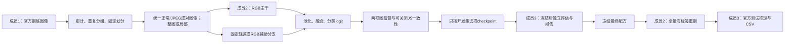

# 架构与方法（与当前实现对应）

成员2负责 `cvdetect/`，成员1负责图像到batch及G/A正式基线，成员3负责模型到正式指标。全流程只使用本项目随机初始化后训练出的权重。

## 输入和骨干

输入 raw RGB `[B,3,H,W]`，float `[0,1]`。模型注册 train 均值方差为 buffer，随 checkpoint 保存。RGB 分支为四阶段、每阶段两个 BasicBlock 的 ResNet-18 型网络；区别于标准 ImageNet ResNet-18：3×3 stride1 stem，无最大池化，默认基础通道32。阶段通道32/64/128/256、分辨率224/112/56/28，全局池化输出256维。

辅助分支为三层3×3 stride2卷积 + BatchNorm + ReLU，通道32/64/128，池化后128维；与RGB特征拼成384维，线性层输出一个logit。单分支直接256维分类。模型不包含权重下载或预训练加载。

残差定义 `r(x)=x−AvgPool3×3(reflect_pad(x))`，从 raw RGB 计算，再除以同一固定通道标准差。双RGB对照使用完全相同辅助层和融合头，仅将输入改为归一化RGB。两种辅助结构参数量严格相同。

## 损失与训练

对正常和JPEG视图分别得logit z/z'。总损失为 `0.5(BCE(z,y)+BCE(z',y)) + λ(t)JS(Bernoulli(sigmoid(z)),Bernoulli(sigmoid(z')))`。JS采用log空间实现，避免饱和概率导致log(0)。λ在总步数前10%从0升至0.1；无一致性配置固定0。

同一batch的两种视图拼在一起前向，避免BatchNorm运行均值总是被后输入的JPEG单独更新。每个训练step都有相同数量双视图，训练Accuracy按正常视图计算。开发验证只使用正常单视图、固定取样，阈值0.5。AdamW和cosine调度在七组中共用。

## 成员1/3接口与限制

图像划分、反射填充、几何变换、JPEG编码和裁剪由成员1统一实现。当前team_data.py已对接完整官方训练数据，配方、统计与真实batch核验见数据审计报告和validation/data_pipeline_report.json。历史synthetic fixture仅用于工程验证。

成员3负责单/五patch、JPEG Q90/70/50/30、同区域缩放、分层指标、配对bootstrap和CSV。模型加载接口已提供；这些正式评估逻辑尚未实现，不能把“有加载接口”理解为评估已完成。

## 追溯与恢复

正式run保存config、metadata、environment、逐epoch JSONL、best/last权重与优化器/调度器/AMP/RNG状态、最佳开发逐图预测。源码SHA256、划分SHA256和data_revision绑定checkpoint。恢复仅接受同run的last.pt，并核对配置、元数据、源码和日志epoch。

checkpoint写入使用临时文件替换；跨文件写入并非数据库事务。若进程恰在写权重和写日志之间中止，恢复会明确提示不一致，需要保留材料后人工核对，不会自动吞掉或篡改结果。
